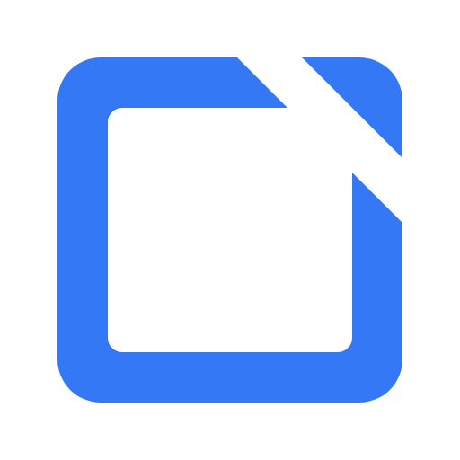

# XShot



*上图为现有项目标志，暂作展示占位；需要用户提供产品截图/GIF。*

独立实现的原生 macOS 截图与产品演示工具。0.2.0 包含窗口、区域与整屏截图、标注、复制与 PNG 保存、桌面贴图，以及自动缩放录屏和可点击步骤演示。

## 运行

双击 `Run XShot.command`，或运行 `./scripts/build.sh` 后打开 `dist/XShot.app`。需要 Apple Silicon Mac、macOS 14 或更新系统和 Xcode Command Line Tools。

构建后可将 `dist/XShot.app` 拖入“应用程序”，再从聚焦搜索 XShot 启动。

全局快捷键为 **⌥X（Option + X）** 截图、**⌥R（Option + R）** 打开产品演示或完成录制、**⌥P（Option + P）** 暂停/继续录制；菜单栏也提供入口。首次截图或录制需允许 XShot 访问屏幕，刚授权后若无法采集，请重新打开应用。未授权时仍可打开本地图片进行标注。

## 安装 / 故障排除（非 App Store）

XShot **不在 App Store**。直接下载或自行构建的 `XShot.app` 首次打开时，macOS 可能提示「已损坏，无法打开」或「无法打开，因为来自身份不明的开发者」。这通常是 Gatekeeper / 隔离属性导致，可按下面步骤处理：

1. **右键打开**：在 Finder 中对 `XShot.app` 按住 Control 点击（或右键）→ 选择「打开」→ 在对话框中再点「打开」。第一次需要这样绕过 Gatekeeper。
2. **系统设置放行**：打开「系统设置」→「隐私与安全性」，在被拦下的提示附近点「仍要打开」/允许该 App。截图与录制还需在「屏幕与系统音频录制」中授权。
3. **清除隔离属性**（仍打不开时，在终端执行，路径按实际位置改）：

```bash
xattr -cr /Applications/XShot.app
```

4. **可选：核对签名**（自行构建或附带签名的包）：

```bash
codesign --verify --deep --strict /Applications/XShot.app
```

本地 `./scripts/build.sh` 生成的 `dist/XShot.app` 同样适用上述步骤。

## 截图与标注

按 **⌥X**，鼠标移到窗口上会自动高亮边界，单击即可选中；直接拖动仍为手动框选。选好后浮动工具栏直接提供选择、矩形、箭头、画笔、文字与马赛克画笔，以及随工具切换的颜色、线宽、字号或笔刷大小、撤销、重做和清空。无需先打开编辑器，按 **Enter / ⌘C** 或点击“复制”即可复制并结束截图，回到原应用用 **⌘V** 粘贴；**⌘S** 或“保存”直接保存 PNG，取消保存会返回原选区与标注。

窗口截图按真实宽高获取完整窗口，保留 Retina 像素，不包含系统外阴影；可见部分的标注与完整图像坐标一致。标注前可拖动选区内部移动，或拖动四边、四角调整大小；调整后按手动区域截图处理。添加标注后固定选区，避免调整范围时丢失内容，清空标注后可继续调整。点击“编辑器”可继续美化、贴图与编辑，已有标注及撤销历史会一起保留，并在首次打开时自动复制。

点击右上角“整个屏幕”或按 **⌘A** 可选中当前显示器；Esc 取消。手动框选与整屏截图各限单块显示器，独立窗口截图不受单屏可见边界限制。

标注支持矩形、箭头、画笔、文字与马赛克画笔，可调整颜色、线宽或笔刷大小；⌘Z 撤销、⌘⇧Z 重做、⌘C 复制、⌘S 保存。文字工具点击空白处输入，Enter 换行，⌘Enter 或点击输入框外完成；输入框随文字增长，长行可水平滚动，不会提前折行。文字默认按当前画面约 28 点显示，自动补偿 Retina 和画布缩放，避免大图缩小时文字过小；手动选择字号后保持用户数值。字号独立于线宽，输入中和提交后都能调整字号与颜色。单击已有文字选中后拖动，双击重新编辑；输入中也可拖动边框移动。方向键微调 1 像素，Shift 加速到 10 像素，Delete 删除选中的文字；Esc 取消本次修改，保留原文字。所有标注均支持 V 选择、拖动移动、手柄缩放、方向键微调与 Delete 删除；选中后可修改颜色、线宽、字号或笔刷大小，操作均可撤销重做。箭头端点可以直接调整，矩形在绘制工具下也能拖动已显示的手柄。

马赛克按住鼠标沿路径涂抹，支持单击点涂、圆形笔刷与独立直径；松开后可继续下一笔，⌘Z 一次撤销一整笔。效果包含已绘制的标注，未涂抹的区域保持原样。马赛克模式下颜色控件禁用，以免产生无法改变效果的操作。

原生窗口快捷键同样可用：⌘W 关闭当前窗口、⌘M 最小化、⌘H 隐藏 XShot、⌥⌘H 隐藏其他应用、⌃⌘F 切换全屏。文字输入时保留 macOS 标准文本编辑快捷键；“文件”和“窗口”菜单提供对应操作。

框选界面与编辑器共用以下标注快捷键，工具按钮直接显示对应字母，保存和复制按钮直接显示 **⌘S / ⌘C**；点击问号或按 **?** 可查看当前界面的完整快捷键。输入标注文字时，字母、数字和符号正常输入；编辑器的缩放或工具栏控件获得焦点后，仍可使用截图快捷键。

| 操作 | 快捷键 |
| --- | --- |
| 矩形 / 箭头 / 画笔 / 文字 / 马赛克 | R / A / P / T / M |
| 红 / 橙 / 黄 / 绿 / 蓝 / 紫 / 黑 / 白 | 1–8 |
| 减小 / 增大线宽、字号或马赛克笔刷 | [ / ] |
| 撤销 / 重做 | ⌘Z / ⇧⌘Z |
| 清空标注（可撤销） | ⇧⌘⌫ |
| 选择标注 / 未标注时调整截图范围 | V |
| 移动所选标注或截图范围 | 方向键，⇧方向键加速 |
| 从框选打开编辑器 | ⇧⌘E |
| 编辑器美化 / 贴图 | ⇧⌘B / ⇧⌘P |
| 编辑器放大 / 缩小 | ⌘+ / ⌘− |
| 编辑器原始像素 / 适合窗口 | ⌘1 / ⌘9 |

选中标注时，方向键移动该标注；没有标注时可移动截图选区。每次移动 1 个原图像素，按住 Shift 移动 10 像素，自动限制在当前画布或屏幕内。标注后固定选区，清空后可再次移动或选择整屏；移动已选窗口的区域会转为当前屏幕的区域截图。

编辑器顶部为标注工具栏与复制、保存、贴图按钮；底部显示尺寸及缩放。窄窗口优先保留标注工具、保存和复制，其他操作可从工具栏溢出菜单进入。默认画布随窗口自动适配；手动缩放后可点击“适合窗口”恢复。

首次使用默认采用“轻影”：透明背景、24 px 留白、12 px 圆角、柔和阴影与细边框，自动复制同样带上该效果。点击右上的“美化”，可选择原图、轻影、留白、展示四种预设，或调整背景、留白、圆角、阴影与细边框。透明、纯白、雾灰、深灰及蓝色渐变背景均可用。效果同步用于画布预览、复制、PNG保存和贴图；留白严格按设置数值输出，0 px 不增加边距，超出导出画布的阴影会裁切。底部显示实际输出尺寸。选择“原图”或“恢复原图”即可关闭美化，原图与已有标注保留。

按 **⌘,**，或点击主界面、编辑器、框选工具栏的齿轮及应用/菜单栏中的“设置…”，可打开设置。支持带实时预览的默认美化、默认标注颜色与线宽，以及截图进入编辑器时自动复制；修改自动保存，重启后保留。“恢复默认设置”可恢复轻影、红色、4 px 和自动复制。默认美化同时用于框选直接复制/保存与新建编辑器；单张图片在编辑器中调整的效果独立保留。从框选界面打开设置会暂时收起选区，关闭设置后恢复选区与标注，并使用更新后的默认输出效果。

右侧使用清晰的代码窗口样图，美化预览与标注示例分开。常用留白范围保持 100% 缩放，改变留白时主体不缩小；“原图 / 效果”可按相同位置和比例切换对比，不会修改已保存的设置。透明背景不再铺设大块网格，只有实际导出边界以细虚线标示。颜色和线宽实时反映到独立的矩形、箭头示例，拖动圆角滑块时持续刷新。

编辑器和贴图复制成功后都会显示醒目的勾选提示与粘贴说明，复制按钮短暂变为绿色勾选。提示约 3 秒后自动消失，不拦截画布操作。打开本地图片或重新显示已有编辑器不会自动覆盖剪贴板。

贴图支持拖动、缩放、复制、保存和多窗口并存。右下角悬浮条提供复制、保存和更多；右键或“更多”可选择缩放比例、透明度或关闭；菜单栏可统一隐藏或显示贴图。

## 产品演示 · 0.2

按 **⌥R**，选择“屏幕 / 窗口 / 区域”，确认画面预览并命名。倒计时可选无、3 秒或 5 秒；开始时准备页隐藏，目标范围显示边框与独立倒计时。控制器提供暂停/继续、重新录制和完成；**⌥P** 暂停/继续，**⌥R** 完成并进入编辑器。重录会先保存上一条独立项目。XShot 自身窗口从录制画面排除；原片、鼠标轨迹、点击和步骤截图仅保存到本机。

录制期间会收起其他 XShot 工作窗口；结束后只显示当前演示编辑器，主窗口不会自动遮挡它。取消或启动失败时恢复原窗口，原有截图与编辑状态保留。

编辑器右侧“保留范围”支持按当前位置设置入点/出点，去掉准备与收尾片段；可撤销或恢复整段。预览与 MP4 导出采用同一范围，原始视频与交互步骤保留。

- **演示视频**：根据点击安排平滑缩放，邻近连续点击合并为稳定焦点，连续操作之间平滑切换镜头；可修改片段起止时间、倍数、启用状态，并在画面中重新定位焦点。自动聚焦、鼠标和点击提示可分别关闭。预览使用随屏幕刷新同步的 GPU 渲染，与导出共享镜头轨迹和合成器；导出 H.264 MP4，保持原片尺寸，固定 60 fps，即使原片静止段没有新帧，鼠标和缩放仍按播放时间继续变化。
- **交互步骤**：自动生成点击前的步骤截图与最终结果图。通过缩略图编辑标题、说明、热点和跳转目标；可拖动热点、增删重排步骤，并撤销重做。切换“预览”可按热点体验分支、返回和重新开始。
- **离线 HTML**：导出内嵌图片、文字与播放器的单个 HTML 文件，在浏览器离线播放，无需服务器。它是截图式可点击演示，不会操作真实产品，也不克隆网页 DOM。继续编辑请打开原项目。

项目默认保存在 `~/Movies/XShot/` 的 `.xshotdemo` 包中，包含 `recording.mov`、`project.json` 和 `steps/`。编辑自动保存；用准备页“最近项目”、“打开项目…”或 **⌘⇧O** 重开。MP4 导出可取消，原片与项目保留，已有导出目标仅在新导出成功后替换。

当前支持单显示器整屏、单个独立窗口或单屏内框选区域；原片宽度最高 1920 像素、目标最高 60 fps，**不含音频**。暂停不增加有效时长，也不采集鼠标和步骤。尚无录音/系统音频、摄像头、云分享、AI 说明或敏感信息打码。自动步骤使用通用标题和说明，需要按实际操作编辑。功能参考与详细范围见 [产品演示说明](Docs/PRODUCT-DEMO.md)，本轮对标见 [录制体验改进](Docs/RECORDING-EXPERIENCE.md)。

## 验证

运行 `./scripts/check-annotation-interactions.sh` 逐项验证五种标注的绘制、命中、选中移动、手柄缩放、属性修改、微调、删除、清空与撤销重做；另检查 25%/50%/100%/200% 下默认文字的可读大小、连续笔刷、马赛克路径外像素保护、点涂、笔刷直径和六个原生工具按钮。详情见 [标注交互验收](Docs/ANNOTATION-INTERACTION-QA.md)。

运行 `./scripts/check-text-annotations.sh` 可检查多行文字、长行不折行与光标滚动、中文/Emoji/输入法组合态、空格和空行保留、独立字号与颜色、原位重编、拖动/微调/删除/取消、逐次撤销重做，以及 50%/100%/200% 缩放坐标和工具栏焦点。使用合成图像与隐藏窗口，输出位于 `artifacts/text-annotation-checks/`。

运行 `./scripts/check-settings.sh` 可检查设置持久化、⌘, 与界面入口、各项参数改变后的图片与视图像素更新、连续滑块刷新、阴影边距说明、固定预览尺寸、明暗外观、框选/编辑器共用默认值、关闭自动复制、现有编辑器效果保留、恢复默认及异常数据。使用独立偏好与剪贴板、隐藏窗口，界面预览保存在 `artifacts/settings-checks/`。

运行 `./scripts/check-selection-annotations.sh` 可检查框选后五种工具的事件命中、Retina 坐标、撤销重做、选区保护、直接复制/保存/Enter、默认轻影、可编辑画布交接、完整窗口坐标、过期请求取消及录屏隔离。检查使用合成图像、独立剪贴板和隐藏窗口；界面与输出预览保存在 `artifacts/selection-annotation-checks/`。

运行 `./scripts/check-keyboard-shortcuts.sh` 可检查原生菜单快捷键的响应链、窗口关闭与关闭保护，以及工具/颜色/线宽、缩放/贴图/清空、进行中的笔画保护、修饰键隔离与文字输入。`check-selection-annotations.sh` 同时覆盖 Retina 方向键微调、选区边界与标注保护、画布焦点整屏选择及快捷键打开编辑器。检查使用隐藏窗口与合成键盘事件，不向桌面发送输入。

运行 `./scripts/check-clipboard.sh` 可检查截图仅首次自动复制、默认轻影、PNG/TIFF 格式与像素、手动和贴图复制反馈、连续操作的提示时序，以及打开本地图片和重新显示窗口时保留剪贴板。检查使用独立剪贴板和隐藏窗口。

运行 `./scripts/check-rendering.sh` 可检查导出像素、方向、透明度、标注坐标、撤销与重做。检查图片写入 `artifacts/rendering-check.png`。

运行 `./scripts/check-window-selection.sh` 可检查窗口命中顺序、多屏坐标、单击吸附、拖动框选、选区调整、整屏选择及录屏选区兼容性。多屏几何检查使用合成坐标，真实设备验证边界见 `VERIFICATION.md`。

运行 `./scripts/check-beautification.sh` 可检查美化输出、透明圆角、阴影边缘、画布坐标和切换样式后的撤销重做。验证记录见 `BEAUTIFICATION-QA.md`。

产品演示的专项检查：

```sh
./scripts/check-demo-recorder.sh
./scripts/check-demo-video.sh
./scripts/check-interactive-demo.sh
./scripts/check-demo-studio.sh
```

分别覆盖录制写入与项目模型、真实短片导出及 VFR 静态段效果、交互播放器与离线导出，以及编辑器原生控制动作的定位、暂停和裁剪保存。这些单元、合成媒体和隐藏窗口控制检查已通过；真实安装版桌面操作的结果与边界见 [VERIFICATION.md](VERIFICATION.md)。

## 标志与应用图标

已采用 A「开角」：蓝色画框在右上打开一角，搭配纯白 macOS 图标底。主窗口、菜单栏和应用图标使用同一标志。矢量、黑白版本、字标组合及网页图标位于 `Design/Logo/Final/`，使用与重建说明见其中的 `GUIDE.md`。

`python3 scripts/make-icons.py` 可重建图标资源；常规构建直接使用 `Resources/` 内的 PNG 与 ICNS，不需要图像生成服务。

## 贡献与许可证

欢迎提交 Issue 和 PR，开发环境与检查流程见 [CONTRIBUTING.md](CONTRIBUTING.md)。本项目采用 [MIT 许可证](LICENSE)。

## 实现来源

- 项目源代码由本项目独立编写，使用苹果公开系统框架：AppKit、ScreenCaptureKit、AVFoundation、Core Image、Core Graphics、WebKit、Carbon（全局快捷键）；没有外部代码依赖。
- 需求与交互研究参考了公开可见的截图和演示工具体验，感谢 [iShot](https://www.better365.cn/ishot.html)、[Screen Studio](https://screen.studio/)、[Cap](https://cap.so/)、[Arcade](https://www.arcade.software/product/interactive-demo) 与 [Supademo](https://supademo.com/features/guided-demos) 提供的产品参考。相关名称与商标归各自权利人所有；列出参考不表示关联或背书。
- 本项目未复用上述产品的源码、反编译代码、二进制或资产。早期调研包含对本机已安装参考应用的版本、依赖及类名的只读检查；未采用反汇编或反编译实现，不将开发过程描述为严格的隔离式 clean-room。
- API 文档：[SCScreenshotManager](https://developer.apple.com/documentation/screencapturekit/scscreenshotmanager)。

长截图与 OCR 不在当前版本范围内。
